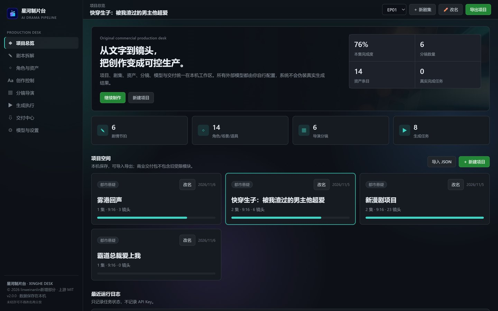
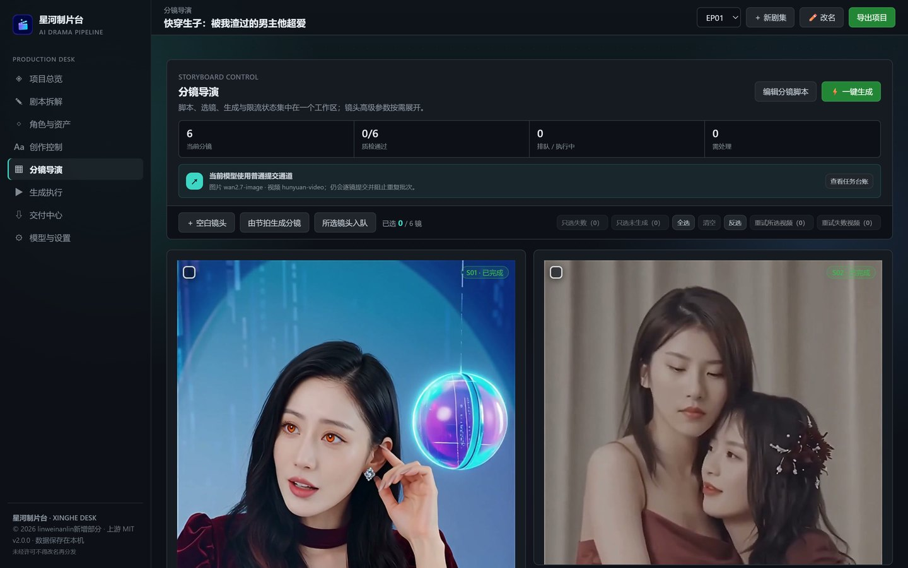
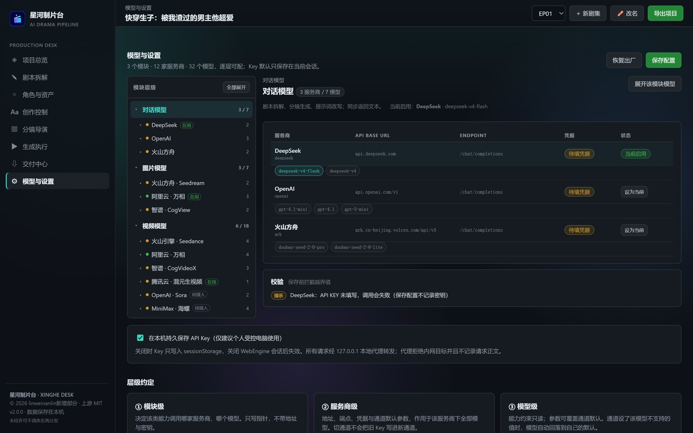
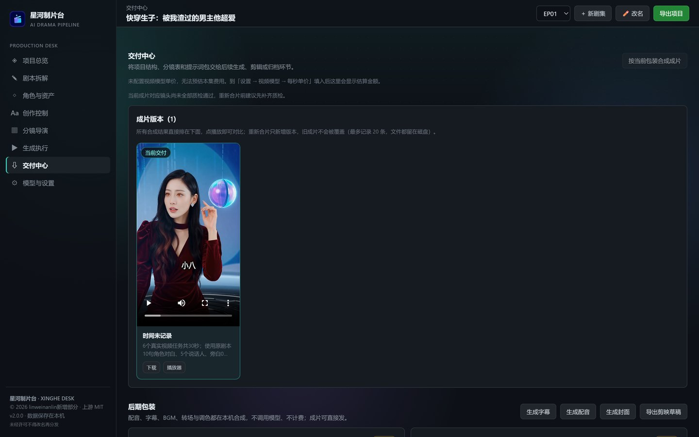

# 星河制片台 · Xinghe Production Desk

> 从文字到镜头：把一部竖屏短剧/漫剧的「剧本 → 节拍 → 资产 → 分镜 → 生成 → 交付」放进一个本机工作台。
> 桌面应用（PySide6 + 本地 HTTP 服务），所有模型调用由使用者自己配置，不伪造生成结果。

**这是一个展示仓（showcase repo），不包含源代码。** 源码在私有仓库，获取方式见 [源码访问](#源码访问)。

<p>
  
  
  
  
</p>



## 这是什么

一个面向**短剧 / 漫剧生产**的本地桌面工作台。它把原来散落在十几个脚本、几十个 Excel 和一个网盘文件夹里的流程，收成了一条可视化的流水线：写完剧本后，节拍、角色设定、分镜画面、生成任务、成片与字幕都在同一个界面里推进，进度和缺口一眼能看到。

它不是「一键出片」的玩具。生成结果依赖你自己配置的模型服务（OpenAI、火山方舟、阿里云百炼、智谱、腾讯混元等），系统只负责编排、调度、校验和打包，不会用占位图假装生成成功。

## 界面

| 分镜导演 | 模型与设置 |
|---|---|
|  |  |



> 截图均为真实运行界面。剧本正文属于未发表内容，此处不放剧本页。

## 核心能力

| 模块 | 做什么 |
|---|---|
| 项目 / 剧集 | 多项目并存、按集推进；项目可导出为 JSON，换机不丢；支持从旧安装一键搬迁项目与媒体 |
| 剧本拆解 | 剧本编辑、AI 续写 / 改写、本地拆情节节拍、历史版本回滚 |
| 角色与资产 | 角色 / 场景 / 道具三类资产，定妆图、三视图、变体管理，提示词编辑与历史归档 |
| 创作控制 | 镜头级参数（景别、运镜、风格、音轨等）按能力字段动态渲染，不出现无意义选项 |
| 分镜导演 | 由节拍一键生成分镜、镜头入队、失败重试与筛选、逐镜状态追踪 |
| 生成执行 | 任务队列与并发控制，额度保护开关，请求全部走本地代理，密钥不出本机 |
| 交付中心 | SRT 字幕、分镜 CSV、提示词包、EDL、封面、剪映草稿、ffmpeg 成片合成 |
| 模型与设置 | **四级配置：模块 → 服务商 → 模型 → 参数**，见下节 |

## 技术亮点：把写死的模型配置改成可扩展的四级结构

这是我在这个项目里做得最重的一块，也是最能说明工程能力的地方。

**问题**：原版把 3 个模块（对话 / 图片 / 视频）的模型清单、默认值、表单字段硬编码在界面里。新增一个服务商要改 4 个文件、5 处判断，改漏一处界面就和后端对不上。

**做法**：

```
模块（对话 / 图片 / 视频）
└── 服务商（OpenAI / 火山方舟 / 阿里云百炼 / 智谱 / 腾讯混元 / MiniMax / 海螺 …）
    └── 模型（每个模型自己的能力与默认值）
        └── 参数（类型、范围、枚举、是否真正进请求）
```

- 参数描述符跟着**适配器**走，界面只渲染 schema：新增服务商后表单自动长出来，前端零改动。
- 当前规模：**3 个模块 / 12 家服务商 / 32 个模型 / 99 个参数项**，由脚本从注册表生成单一数据源（`provider-schema`），界面不再有任何硬编码服务商分支。
- 参数取值有明确优先级，避免「服务商默认值污染不兼容模型」：模型级显式值 → 服务商级（需通过兼容性校验）→ 模型默认值。
- 老配置有迁移路径：升级后用户的地址、模型、自定义参数不会被「与预设不一致就重置」的老逻辑抹掉。
- 哪些参数**真的进请求**、哪些只是存档，界面明确标注，不假装生效。

## 工程实践

- **测试**：96 项单元测试（签名清单可验、伪造签名被拒、层级表规模与描述符合法性、模板里不允许有真实密钥，以及提交范围、配音门禁、资产绑定等回归用例）；界面 41 项 CDP 探针（真浏览器点击、真实改动、越界值拦截、未接入通道禁用、老配置迁移、密钥不落盘），全部跑在真实服务上而不是静态托管。
- **出处校验**：33 个源文件的 SHA-256 清单 + RSA-2048 私钥签名；启动时校验，文件被改会点名列出来并拦截启动。私钥不进仓库。
- **零第三方前端依赖**：原生 JS，无框架、无构建步骤，`file://` 或本地服务都能直接跑。
- **密钥策略**：Key 只存在本机、只进内存与本地文件；所有出站请求经 `127.0.0.1` 本地代理，代理拒绝内网目标，不记录请求正文。

## 关于这个项目的来源（如实说明）

本项目基于 MIT 许可的上游项目二次开发（AI Drama Pipeline，`Copyright (c) 2026 AI Drama Pipeline contributors`）。我主导的是架构重构与工程化改造，上游许可与归属见 [NOTICE](NOTICE)，本人贡献清单见下。

我做的主要部分：

- 模型与配置的四级架构、schema 生成、配置界面三层编辑器与参数校验
- 桌面外壳（单窗口、进程守护、热重载、下载处理）与本地服务解耦
- 出处校验体系（清单 + 签名 + 启动拦截）
- 项目搬迁工具、项目改名、若干交互与排版修复

## 源码访问

源码不在本仓库，存放在私有仓库 `linweinanlin/xinghe-production-desk`（未公开，链接对无权限者是 404）。

需要查看完整实现时，可以通过下面任一方式联系我，说明用途即可：

- 邮件：`155627020+linweinanlin@users.noreply.github.com`
- 或在 Issues 里留言（不要贴任何密钥）

通常用于：面试代码评审、技术交流、合作评估。会提供只读权限或安排线上演示。

## 运行环境（供参考）

Windows 10/11 · Python 3.9+ · FFmpeg 在 PATH · 需要自备模型服务的 API Key。

## Roadmap

- [ ] 分镜批量重生成与一致性约束
- [ ] 服务商适配器的在线连通性测试（当前为避免误报未做）
- [ ] 成片的多轨混音与响度标准化
- [ ] 项目级素材查重与空间占用分析

## 许可

本仓库（文档、截图）采用 [展示内容许可 1.0](LICENSE)：可转载链接与引用截图并注明出处，不得整体复制再发布或用于训练。**本许可不涉及源代码**——源码许可见私有仓库内的协议文本。
